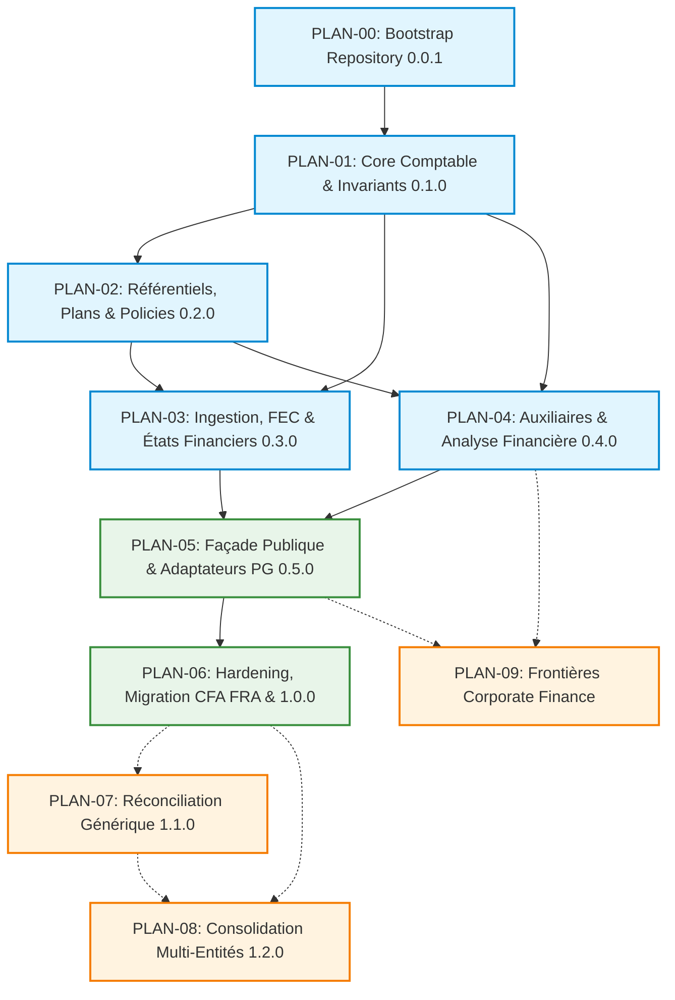

# Index des Plans d'Implémentation Opérationnels — PyAccountingKit

Ce dossier regroupe les **plans d'implémentation modulaires et opérationnels** issus du découpage exhaustif de la feuille de route doctrinale ([`ROADMAP.md`](../ROADMAP.md)).

Chaque plan historique correspond à un jalon de release sémantique clair et définit les lots techniques couverts. Depuis l'audit du 22 octobre 2026, la roadmap produit couvre désormais `LOT-00` à `LOT-46`, avec un overlay tactique de remédiation `REM-00` à `REM-10`. Les `REM-*` ne remplacent pas les plans produit : ils doivent rétablir les invariants et la fiabilité des preuves avant la reprise de la roadmap stratégique.

---

## 0. Priorité d'exécution actuelle — Audit Remediation Overlay

La baseline courante reste :

```text
main
commit audité : 259e9ad665941cd6a9545deb3b92f979d40eae35
version : 0.7.0rc1
```

L'audit du 22 octobre 2026 identifie :

```text
F01 → F27
A01 → A03
```

La promotion stable est donc suspendue pendant la remédiation applicable.

Ordre opérationnel de référence :

```text
REM-00  Baseline / registre / tests correctifs
    ↓
REM-01  Qualification et workflows fiables
    ↓
REM-02  Identités / scope / read-side
    ↓
REM-03  Posting / repositories / idempotence
    ↓
REM-04  Immutabilité / preuves / traçabilité
    ↓
REM-06  Calculs / classification / checksums
    ↓
REM-05  Closing / opening atomiques
    ↓
REM-07  Références / publication sûres
    ↓
REM-08  Contrats publics / services applicatifs
    ↓
REM-09  Auxiliaires persistants si inclus dans le scope
    ↓
REM-10  Qualification transverse / décision de release
```

Puis seulement :

```text
new 0.7 RC if required
    ↓
0.7.0 stable
    ↓
LOT-39 → LOT-46
```

> [!IMPORTANT]
> Les documents de pilotage `33` et `34` sont désormais présents dans le dépôt :
> - [`33_PYACCOUNTINGKIT_NEXT_STEPS_IMPLEMENTATION_PLAN.md`](33_PYACCOUNTINGKIT_NEXT_STEPS_IMPLEMENTATION_PLAN.md)
> - [`34_PYACCOUNTINGKIT_AUDIT_REMEDIATION_AND_ROADMAP_ALIGNMENT.md`](34_PYACCOUNTINGKIT_AUDIT_REMEDIATION_AND_ROADMAP_ALIGNMENT.md)
>
> Les artifacts opérationnels de `REM-00` sont désormais canoniques :
> - [`REMEDIATION_2026_10_PLAN.md`](REMEDIATION_2026_10_PLAN.md)
> - [`../audits/REMEDIATION_2026_10_STATUS.json`](../audits/REMEDIATION_2026_10_STATUS.json)

---

## 1. Vue d'Ensemble des Plans d'Implémentation

| Plan | Intitulé & Périmètre | Lots Couverts | Release Cible | Statut & Prérequis |
| :--- | :--- | :--- | :--- | :--- |
| [`PLAN-00`](PLAN-00_REPOSITORY_BOOTSTRAP_0.0.1.md) | **Bootstrap du Repository & Outillage CI/CD** | `LOT-00` | `0.0.1` | Repository qualifié ; clôture `BLOCKED_EXTERNAL_CONTROL` sur protection de `main` |
| [`PLAN-01`](PLAN-01_ACCOUNTING_CORE_0.1.0.md) | **Moteur Comptable Central & Invariants** | `LOT-01..09` | `0.1.0` | Prérequis : PLAN-00 |
| [`PLAN-02`](PLAN-02_REFERENCES_CHARTS_POLICIES_0.2.0.md) | **Référentiels, Plans Comptables & Policies** | `LOT-10..13` | `0.2.0` | Prérequis : PLAN-01 |
| [`PLAN-03`](PLAN-03_IMPORTS_REPORTING_0.3.0.md) | **Ingestion, FEC & États Financiers** | `LOT-14..17` | `0.3.0` | Prérequis : PLAN-01, PLAN-02 |
| [`PLAN-04`](PLAN-04_SUBLEDGERS_FINANCIAL_ANALYSIS_0.4.0.md) | **Comptes Auxiliaires & Analyse Financière** | `LOT-18..20` | `0.4.0` | Prérequis : PLAN-01, PLAN-02 |
| [`PLAN-05`](PLAN-05_PUBLIC_API_ADAPTERS_0.5.0.md) | **Façade Publique & Adaptateurs PostgreSQL** | `LOT-21..24` | `0.5.0` | Prérequis : PLAN-01..04 |
| [`PLAN-06`](PLAN-06_MIGRATION_CFA_FRA_HARDENING_1.0.0.md) | **Hardening, Migration CFA FRA & Release 1.0.0** | `LOT-25..30` | `1.0.0` | Prérequis : PLAN-05 (G5) |
| [`PLAN-07`](PLAN-07_RECONCILIATION_1.1.0.md) | **Réconciliation Générique & Rapprochement Bancaire** | `LOT-31..33` | `1.1.0` | Extension post-1.0 |
| [`PLAN-08`](PLAN-08_CONSOLIDATION_1.2.0.md) | **Consolidation Multi-Entités & Devises** | `LOT-34..37` | `1.2.0` | Extension post-1.0 |
| [`PLAN-09`](PLAN-09_CORPORATE_FINANCE_BOUNDARIES.md) | **Garde-fous & Frontières Corporate Finance** | `LOT-38` | Phase P2.3 | Transversal & Continu |

### Statut de cette table

Les fichiers `PLAN-00 → PLAN-09` restent les plans historiques de découpage produit. Ils ne décrivent pas à eux seuls la priorité d'exécution actuelle.

La séquence désormais autoritative est :

```text
REM-00 → REM-10
        ↓
0.7 release decision
        ↓
LOT-39 → LOT-46
```

Les nouveaux lots stratégiques ne disposent pas encore tous d'un fichier `PLAN-xx` dédié dans ce dossier ; ils sont définis dans `docs/ROADMAP.md` et les specs `24 → 32` puis `35 → 38`.


---

## Lot actif / qualification

### Priorité active : `REM-06 → REM-10`

La priorité n'est plus la promotion directe de `LOT-27 / 0.7.0rc1`.

Le chantier courant est l'overlay de remédiation :

| Ordre | Lot | Objet | Constats principaux |
|---:|---|---|---|
| 1 | `REM-00` | Baseline, registre et conventions correctives — **DONE** | Tous |
| 2 | `REM-01` | Qualification et workflows fiables — **IMPLEMENTED / QUALIFYING** | `F25,F26,F27` |
| 3 | `REM-02` | Identités, scope et read-side — **IMPLEMENTED / QUALIFYING** | `F01,F02,F03,F04,F13,F18` |
| 4 | `REM-03` | Cycle de posting, repositories, idempotence — **IMPLEMENTED / QUALIFYING** | `F10,F11,F23,F24` |
| 5 | `REM-04` | Immutabilité et traces durables — **IMPLEMENTED / QUALIFYING** | `F14,F20,A03` |
| 6 | `REM-06` | Calculs, classification et empreintes — **ACTIVE** | `F12,F15,F16,F21` |
| 7 | `REM-05` | Clôture et à-nouveaux atomiques | `F05,F06,F07,F08,F09` |
| 8 | `REM-07` | Références sûres et publication validée | `F19,F22` |
| 9 | `REM-08` | Contrats publics et services applicatifs | `F17,A02` |
| 10 | `REM-09` | Auxiliaires persistants | `A01` |
| 11 | `REM-10` | Qualification transverse / décision de release | Tous |

### Plans/release historiques toujours pertinents

- [`LOT-27_REGULATORY_PRODUCTION_QUALIFICATION_PLAN.md`](LOT-27_REGULATORY_PRODUCTION_QUALIFICATION_PLAN.md)
  — reste la référence du scope réglementaire `0.7`, mais sa qualification ne suffit plus à elle seule à autoriser la stable tant que les P1 applicables issus de l'audit ne sont pas fermés.
- [`RELEASE_0.7.0_STABLE_PROMOTION_PLAN.md`](RELEASE_0.7.0_STABLE_PROMOTION_PLAN.md)
  — reste le contrat G5 externe ; G5 est nécessaire mais non suffisant.
- [`LOT-26_CFA_FRA_CONSUMER_CONVERSION_AND_LEGACY_RETIREMENT_PLAN.md`](LOT-26_CFA_FRA_CONSUMER_CONVERSION_AND_LEGACY_RETIREMENT_PLAN.md)
  — le travail live CFA FRA reste différé ; aucune preuve technique ne doit être requalifiée artificiellement en preuve live.
- [`LOT-25_CFA_FRA_GOLDEN_BASELINE_IMPLEMENTATION_PLAN.md`](LOT-25_CFA_FRA_GOLDEN_BASELINE_IMPLEMENTATION_PLAN.md)
  — baseline/golden historique toujours utilisée comme non-régression.
- [`RELEASE_0.5.0_STABLE_PROMOTION_PLAN.md`](RELEASE_0.5.0_STABLE_PROMOTION_PLAN.md)
  — dernière ligne stable complète historique.

### Tranche active

```text
REM-00  DONE
REM-01  IMPLEMENTED / QUALIFYING
REM-02  IMPLEMENTED / QUALIFYING
REM-03  IMPLEMENTED / QUALIFYING
REM-04  IMPLEMENTED / QUALIFYING
REM-06  ACTIVE
```

Preuves d'implémentation REM-04 :

```text
PR #83  F14/F20
PR #84  A03
```

Les findings REM-04 restent `FIXED_UNVERIFIED` jusqu'à preuve de qualification sur le SHA exact de `main` et requalification transverse REM-10.

Sorties attendues de REM-06 :

```text
F12 proposal-to-entry fidelity preserves EntryType
F15 trial-balance checksum includes account identity and currency semantics
F16 allocation preserves cents without premature rounding
F21 sign conventions cannot be applied twice
```


## 2. Graphe d'Ordonnancement & Chemin Critique

### 2.1 Chemin critique actuel

```text
0.7.0rc1
    │
    ▼
REM-00
    ↓
REM-01
    ↓
REM-02
    ↓
REM-03
    ↓
REM-04
    ↓
REM-06
    ↓
REM-05
    ↓
REM-07
    ↓
REM-08
    ↓
REM-09 (selon scope)
    ↓
REM-10
    ↓
release decision
    ↓
new RC if required
    ↓
0.7.0 stable
    ↓
LOT-39 Architecture Fitness
    ↓
LOT-43 Testing Toolkit
    ↓
35 Business Lifecycles
    ↓
36 State Machines
    ↓
37 Domain Event Coverage
    ↓
38 Lifecycle / State / Event Mapping
    ↓
25 Event Envelope / Causality
    ↓
LOT-40 Domain Events
    ↓
LOT-41 Reproducibility
    ↓
LOT-42 Golden / Concurrency
    ↓
LOT-44 Recovery
    ↓
0.8.x
    ↓
0.9.x API / Schema Freeze
    ↓
1.0.0
    ↓
LOT-45 / LOT-46 post-1.0
```

### 2.2 Graphe historique PLAN-00 → PLAN-09

Le graphe ci-dessous reste utile pour comprendre le découpage historique des plans produit. Il ne représente plus l'ordre immédiat de travail depuis l'audit du 22 octobre 2026.

### Aperçu Schématique (Vue ASCII Textuelle)

```text
┌──────────────────────────────────────────────────────────────────┐
│              PLAN-00 : Bootstrap Repository (0.0.1)              │
└────────────────────────────────┬─────────────────────────────────┘
                                 │
                                 ▼
┌──────────────────────────────────────────────────────────────────┐
│           PLAN-01 : Core Comptable & Invariants (0.1.0)          │
└──────────────┬─────────────────┬─────────────────┬───────────────┘
               │                 │                 │
               ▼                 │                 │
┌──────────────────────────────┐ │                 │
│ PLAN-02 : Référentiels,      │ │                 │
│ Plans & Policies (0.2.0)     │ │                 │
└──┬───────────────────────┬───┘ │                 │
   │                       │     │                 │
   │         ┌─────────────┼─────┘                 │
   │         │             │                       │
   ▼         ▼             ▼                       ▼
┌────────────────────────┐ ┌───────────────────────────────────────┐
│ PLAN-03 : Ingestion,   │ │ PLAN-04 : Comptes Auxiliaires         │
│ FEC & Reporting (0.3.0)│ │ & Analyse Financière (0.4.0)          │
└────────────┬───────────┘ └───────┬───────────────────────────────┘
             │                     │               :
             │       ┌─────────────┘               :
             ▼       ▼                             ▼
┌───────────────────────────────────────┐   ┌──────────────────────┐
│ PLAN-05 : Façade Publique             │:::> PLAN-09 : Garde-fous │
│ & Adaptateurs PostgreSQL (0.5.0)      │   │ Corporate Finance    │
└──────────────────┬────────────────────┘   │ (P2.3 / Continu)     │
                   │                        └──────────────────────┘
                   ▼
┌──────────────────────────────────────────────────────────────────┐
│ PLAN-06 : Hardening, Migration CFA FRA & Release 1.0.0           │
└──────────────┬───────────────────────────────────────────────────┘
               : (Extensions post-1.0)
       ........:........................
       :                               :
       ▼                               ▼
┌──────────────────────────────┐       ┌───────────────────────────┐
│ PLAN-07 : Réconciliation     │......>│ PLAN-08 : Consolidation   │
│ Générique & Banque (1.1.0)   │       │ Multi-Entités (1.2.0)     │
└──────────────────────────────┘       └───────────────────────────┘
```

### Définition Formelle Mermaid (pour viewers avec extension)



---

## 2.3 Extension stratégique issue des specs `24 → 38`

| Lot | Objet | Specs principales | Horizon |
|---|---|---|---|
| `LOT-39` | Architecture Fitness Functions | `24` | `0.8.x` |
| `LOT-40` | Domain Events / Causality / Envelope | `25,35,36,37,38` | `0.8.x` |
| `LOT-41` | Reproducibility & Computation Manifests | `26` | `0.8.x` |
| `LOT-42` | Golden Accounting & Concurrency | `27` + transition/event matrices `35..38` | `0.8.x` |
| `LOT-43` | Testing Toolkit Foundations | `28` | `0.8.x` |
| `LOT-44` | Uncertainty / Recovery / External Effects | `30` | `0.8.x` |
| `LOT-45` | Domain-First Migration Foundations | `29` | post-1.0 progressif |
| `LOT-46` | Financial Semantic Layer Foundations | `31` | post-1.0 |

La spec `32` constitue la doctrine d'architecture transversale :

```text
DDD
+
Hexagonal / Ports & Adapters
+
Clean dependency direction
```

### Modeling Gate de LOT-40

Les specs `35 → 38` ne créent pas de nouveaux lots. Elles constituent le prérequis de conception de `LOT-40` :

```text
35 Business Lifecycles
    ↓
36 State Machines
    ↓
37 Domain Event Coverage
    ↓
38 Lifecycle / State / Event Mapping
    ↓
25 Event Envelope / Causality
    ↓
LOT-40
```

Entrée minimale dans `LOT-40` :

```text
lifecycle catalog approved
critical transitions identified
event coverage classified
audit/outbox/integration mapping decided
event envelope contract approved
```

Les documents de pilotage associés sont :

- [`33_PYACCOUNTINGKIT_NEXT_STEPS_IMPLEMENTATION_PLAN.md`](33_PYACCOUNTINGKIT_NEXT_STEPS_IMPLEMENTATION_PLAN.md)
- [`34_PYACCOUNTINGKIT_AUDIT_REMEDIATION_AND_ROADMAP_ALIGNMENT.md`](34_PYACCOUNTINGKIT_AUDIT_REMEDIATION_AND_ROADMAP_ALIGNMENT.md)

---

## 3. Système des Portes de Qualité (Gates)

Chaque lot et chaque plan doit valider formellement une ou plusieurs gates avant tout merge ou transition d'état :

### Gates Générales de Release
- **`G0` (Hygiène)** : Linter Ruff, typage Mypy strict, formattage déterministe, import-guards.
- **`G1` (Domaine pur)** : Tests unitaires purs en mémoire sans I/O ni dépendance externe.
- **`G2` (Adaptateurs in-memory)** : Validation des contrats de persistance sur implémentation mock / in-memory.
- **`G3` (Adaptateurs réels)** : Validation sur PostgreSQL réel, gestion des verrous et concurrence. Depuis l'audit `0.7.0rc1`, un module requis skipped, une base indisponible, zéro test collecté, un seul adapter exécuté ou une preuve attachée à un autre SHA font échouer la qualification stricte.
- **`G4` (Stabilité des API & Non-régression)** : Parité de comportement, non-régression de l'arbre d'API.
- **`G5` (Release Candidate & Production)** : zéro BLOCKER/CRITICAL, documentation complète, packaging reproductible et contrôles externes fermés. G5 ne remplace pas la fermeture des P1 métier applicables ni la preuve G3 sur le SHA candidat exact.

### Gates Métier Spécialisées
- **`GA` (Accounting Invariants)** : Équilibre partie double débit=crédit, immuabilité après posting, traçabilité des contrepassations.
- **`GC` (Currency & Rounding)** : Exactitude de la classe `Money`, absence d'arrondi intermédiaire flottant, conservation des centimes.
- **`GP` (Posting & Concurrency)** : Résistance aux courses critiques (concurrence de comptabilisation vs clôture).
- **`GR` (Regulatory Compliance)** : Validation face aux formats légaux (FEC, règles OHADA, schémas PCG).
- **`GI` (Immutability & Audit)** : Impossibilité de muter une écriture comptabilisée ou un snapshot certifié.
- **`GS` (Snapshot & Replay)** : Capacité de rejouer des années d'historique et de recalculer les états sans variation.
- **`GAPI` (Public API Surface)** : Vérification de non-fuite d'ORM ou d'entités internes mutables.
- **`GM` (Migration Parity)** : Égalité stricte avec les résultats de l'ancien moteur CFA FRA.
- **`GSEC` (Security & Supply Chain)** : Absence de dépendances vulnérables, audit SAST, génération de SBOM.

---

## 4. Organisation des Dossiers, Ouvrages & Référentiels

### 4.0. Gouvernance audit / remédiation

La documentation de pilotage doit désormais être lue dans cet ordre :

```text
docs/ROADMAP.md
    ↓
33 Next Steps Implementation Plan
    ↓
34 Audit / Remediation / Roadmap Alignment
    ↓
REM-00..REM-10 operational artifacts
    ↓
implementation / qualification evidence
```

Liens canoniques disponibles :

- [`33_PYACCOUNTINGKIT_NEXT_STEPS_IMPLEMENTATION_PLAN.md`](33_PYACCOUNTINGKIT_NEXT_STEPS_IMPLEMENTATION_PLAN.md)
- [`34_PYACCOUNTINGKIT_AUDIT_REMEDIATION_AND_ROADMAP_ALIGNMENT.md`](34_PYACCOUNTINGKIT_AUDIT_REMEDIATION_AND_ROADMAP_ALIGNMENT.md)
- [`REMEDIATION_2026_10_PLAN.md`](REMEDIATION_2026_10_PLAN.md)
- [`../audits/REMEDIATION_2026_10_STATUS.json`](../audits/REMEDIATION_2026_10_STATUS.json)

Artifacts REM-00 désormais canoniques :

- [`REMEDIATION_2026_10_PLAN.md`](REMEDIATION_2026_10_PLAN.md)
- [`../audits/REMEDIATION_2026_10_STATUS.json`](../audits/REMEDIATION_2026_10_STATUS.json)

État :

```text
REM-00 DONE
REM-01 ACTIVE
```

### 4.1. Structure Générale & Spécifications
- Centre de documentation racine : [`../README.md`](../README.md)
- Feuille de route globale : [`../ROADMAP.md`](../ROADMAP.md)
- Spécifications canoniques : [`../specs/README.md`](../specs/README.md)
  - Cadrage & Vision : [`../specs/00_cadrage/`](../specs/00_cadrage/)
  - Cœur Comptable : [`../specs/01_core-accounting/`](../specs/01_core-accounting/)
  - Opérations du Grand Livre : [`../specs/02_ledger-operations/`](../specs/02_ledger-operations/)
  - Reporting & Analyses : [`../specs/03_reporting-analytics/`](../specs/03_reporting-analytics/)
  - Intégration & Infra : [`../specs/04_integration-infra/`](../specs/04_integration-infra/)
  - Ingénierie & Gouvernance : [`../specs/05_engineering-governance/`](../specs/05_engineering-governance/)
  - Architecture Evolution & Hardening : [`../specs/06_architecture-evolution/`](../specs/06_architecture-evolution/)

### 4.2. Ouvrages de Référence Doctrinale (`docs/books/`)
- 📖 **[Comptabilité générale : Système français et normes IFRS](../books/Comptabilite_Generale_Systeme_Francais_et_Normes_IFRS.md)** (J. Richard, C. Collette — Dunod) : source académique cardinale pour la partie double, les invariants, la théorie de la clôture, l'évaluation et les comptes de groupe consolidés.
- 📊 **[Maxi fiches de Gestion financière de l'entreprise](../books/Maxi_fiches_de_Gestion_financiere_de_l_entreprise.md)** (Dunod) : source de référence pour les Soldes Intermédiaires de Gestion (SIG), le BFR d'exploitation, le FRNG, la CAF, les ratios de liquidité/solvabilité et les frontières Corporate Finance.

### 4.3. Référentiels Réglementaires & Schémas JSON (`docs/referentiels/`)
- 🏛️ **[Jeux de données réglementaires](../referentiels/datasets/)** : datasets officiels structurés (`concepts/`, `raw/`, `structured/`, `crosswalk/`, `reporting/`, `relations/`).
- 📐 **[Schémas JSON de validation](../referentiels/schemas/)** : contrats formels de standards comptables ([`standard.schema.json`](../referentiels/schemas/standard.schema.json), [`accounting-concept.schema.json`](../referentiels/schemas/accounting-concept.schema.json), [`concept-binding.schema.json`](../referentiels/schemas/concept-binding.schema.json), [`standard-relation.schema.json`](../referentiels/schemas/standard-relation.schema.json)).

### 4.4. Actifs Amont & Applications Consommatrices (`resources/`)
- 🏛️ **[CFA FRA Django MVP Sprint 7](../../resources/cfa_fra_django_mvp_sprint_7/)** : application historique de production servant d'**oracle comportemental** (*Behavioral Oracle*), de source des fixtures golden réelles pour la qualification de parité au centime près (`PLAN-06`), et de modèle cible pour l'adaptateur Django/PostgreSQL (`PLAN-05`).
- 📦 **[Regulatory Accounting Data Framework](../../resources/regulatory-accounting-data-framework/)** : framework source amont de données normatives (v0.7.1 - PCG 2026, SYSCOHADA, OHADA EBNL 2023, CEMAC) qui alimente et valide les schémas et datasets de [`docs/referentiels/`](../referentiels/).

### 4.5. Matrice d'Alimentation Doctrinale, Réglementaire & Ressources des Plans

| Plan d'Implémentation | Ouvrages Doctrinales (`docs/books/`) | Référentiels & Schémas (`docs/referentiels/`) | Actifs Amont (`resources/`) |
| :--- | :--- | :--- | :--- |
| **`PLAN-00` (Bootstrap)** | *Comptabilité Générale* (Intangibilité des journaux) | Schémas & Datasets (Validation dès l'amont) | [`resources/`](../../resources/) (Fixtures initiales) |
| **`PLAN-01` (Core)** | *Comptabilité Générale & IFRS* (Partie 1 : Partie double, journal, grand livre, clôture) | Étanche aux juridictions | — |
| **`PLAN-02` (Référentiels)** | *Comptabilité Générale & IFRS* (Nomenclatures, évaluation) | Schémas `standard`, `accounting-concept`, `concept-binding` & Datasets `concepts`, `structured` | [`regulatory-accounting-data-framework`](../../resources/regulatory-accounting-data-framework/) (Forge source) |
| **`PLAN-03` (Reporting)** | *Comptabilité Générale & IFRS* (Bilan, Compte de résultat, Flux) | Datasets `reporting/` | — |
| **`PLAN-04` (Analyse)** | *Maxi Fiches Gestion Financière* (SIG, CAF, FRNG, BFR, DSO, DPO) & *Comptabilité Générale* | Datasets `reporting/` (Regroupements de comptes) | — |
| **`PLAN-05` (API & Adapters)** | *Comptabilité Générale & IFRS* (Intégrité du domaine) | Schémas de validation d'API | [`cfa_fra_django_mvp_sprint_7/apps/`](../../resources/cfa_fra_django_mvp_sprint_7/apps/) (Modèles Django de référence) |
| **`PLAN-06` (Hardening 1.0.0)** | *Comptabilité Générale & IFRS* (Parité légale) | Datasets `raw/` et `structured/` | [`cfa_fra_django_mvp_sprint_7`](../../resources/cfa_fra_django_mvp_sprint_7/) (Oracle de parité & Golden fixtures) |
| **`PLAN-07` (Réconciliation)** | *Comptabilité Générale* (Compte 512) & *Maxi Fiches* (Trésorerie) | Datasets `raw/` (Extraits bancaires réels) | — |
| **`PLAN-08` (Consolidation)** | *Comptabilité Générale & IFRS* (Partie 4 : Comptes de groupe, éliminations, goodwill) | Datasets `crosswalk/` (Transcodification) | — |
| **`PLAN-09` (Frontières Corp Fin)** | *Maxi Fiches Gestion Financière* (Exclusion de DCF, WACC, LBO) | Schémas stricts de non-contamination | — |
