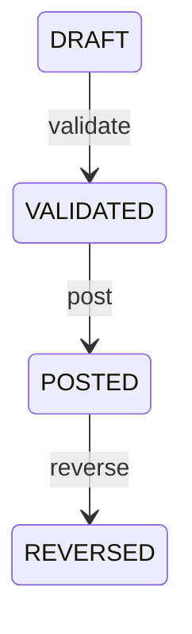

# 36_PYACCOUNTINGKIT_STATE_MACHINES_AND_TRANSITION_RULES.md

# PyAccountingKit — State Machines & Transition Rules

> **Projet** : PyAccountingKit  
> **Document** : `36_PYACCOUNTINGKIT_STATE_MACHINES_AND_TRANSITION_RULES.md`  
> **Statut** : Spécification transverse — machines à états et règles de transition  
> **Date** : 22 octobre 2026  
> **Baseline de modélisation** : `35_PYACCOUNTINGKIT_BUSINESS_LIFECYCLES_ARCHITECTURE.md`  
> **Baseline runtime observée** : PyAccountingKit `0.7.0rc1`  
> **Portée** : formalisation des états, transitions, guards, états terminaux, invariants temporels, concurrence et règles de persistance  
> **Hors scope volontaire** :
> - catalogue complet des Domain Events ;
> - règles d’émission et de causality ;
> - Event Envelope ;
> - Event Sourcing ;
> - moteur générique de workflow.  
> **Documents suivants prévus** :
> - `37_PYACCOUNTINGKIT_DOMAIN_EVENTS_COVERAGE_AND_EMISSION_RULES.md`
> - `38_PYACCOUNTINGKIT_LIFECYCLE_STATE_MACHINE_EVENT_MAPPING.md`

---

# 1. Objet

Cette spécification répond à :

> **Pour chaque objet PyAccountingKit doté d’un lifecycle explicite, quels états existent, quelles transitions sont légales, quelles transitions sont interdites et quelles conditions doivent être satisfaites pour changer d’état ?**

Le document `35` a répondu à :

```text
Which objects have a lifecycle?
```

Le présent document répond à :

```text
How is that lifecycle governed?
```

---

# 2. Principe cardinal

Une machine à états n’est pertinente que lorsqu’elle protège réellement une règle métier.

La cible n’est pas :

```text
status enum everywhere
```

mais :

```text
meaningful lifecycle
+
legal transitions
+
illegal transitions
+
guards
+
terminal semantics
=
explicit state machine
```

---

# 3. Définition canonique

Une machine à états PyAccountingKit est définie par :

```text
StateSet
TransitionSet
GuardSet
TerminalStates
ReentryPolicy
TemporalRules
ConcurrencyRules
PersistenceRules
```

---

# 4. State Machine != Workflow Engine

PyAccountingKit ne doit pas introduire un moteur générique du type :

```text
GenericStateMachine
WorkflowEngine
BPMNRuntime
TransitionDSL
```

dans le cœur métier.

La préférence reste :

```python
entry.validate()
policy_set.activate(...)
period.with_status(...)
allocation.reversed(...)
batch.transition(...)
```

c’est-à-dire :

```text
domain-specific transition methods
```

---

# 5. State Machine != Event Sourcing

La machine à états définit :

```text
current domain state
+
allowed transition
```

Elle ne signifie pas que l’état doit être reconstruit à partir d’une séquence d’événements.

Le modèle canonique reste :

```text
Aggregate state
    ↓
Repository
    ↓
UnitOfWork
```

---

# 6. State Machine != Domain Event

Une transition répond à :

```text
may I move from A to B?
```

Un event répond à :

```text
what meaningful business fact occurred?
```

Le lien entre les deux sera traité dans `38`.

---

# 7. Taxonomie des transitions

PyAccountingKit distingue :

```text
T1 — FORWARD_TRANSITION
T2 — REVERSAL_TRANSITION
T3 — REOPEN_TRANSITION
T4 — SUPERSESSION_TRANSITION
T5 — TERMINAL_TRANSITION
T6 — DERIVED_TRANSITION
T7 — PROCESS_TRANSITION
T8 — RECOVERY_TRANSITION
```

---

# 8. T1 — Forward Transition

Exemple :

```text
DRAFT
  ↓
VALIDATED
```

Transition normale vers un état métier plus avancé.

---

# 9. T2 — Reversal Transition

Exemple :

```text
POSTED
  ↓
REVERSED
```

La reversal ne doit jamais être confondue avec :

```text
mutation backward
```

Elle produit généralement :

```text
compensating accounting object
+
historical link
```

---

# 10. T3 — Reopen Transition

Exemple :

```text
CLOSED
  ↓
REOPENED / OPEN
```

Elle nécessite souvent :

```text
authorization
reason
audit evidence
downstream staleness
```

---

# 11. T4 — Supersession Transition

Exemple :

```text
ACTIVE
  ↓
SUPERSEDED
```

Sémantique :

```text
historically preserved
no longer current
```

---

# 12. T5 — Terminal Transition

Exemple :

```text
IMPORTING
  ↓
COMPLETED
```

Après laquelle :

```text
ordinary forward mutation
=
forbidden
```

---

# 13. T6 — Derived Transition

Exemple :

```text
DueItem
```

Le statut n’est pas persistant :

```text
open_amount
→ derived business state
```

Ce type de lifecycle ne nécessite pas nécessairement une machine à états explicite.

---

# 14. T7 — Process Transition

Exemple :

```text
READY
  ↓
IMPORTING
  ↓
COMPLETED
```

Le statut décrit une étape durable d’un processus.

---

# 15. T8 — Recovery Transition

Exemple futur :

```text
UNCERTAIN
  ↓
RECONCILING
```

Ce type est particulièrement important pour `LOT-44`.

---

# 16. Règle d’autorité

Pour un objet donné :

```text
one canonical transition authority
```

Une transition ne doit pas être reproduite indépendamment dans :

```text
domain
application
ORM
public API
```

avec des règles divergentes.

---

# 17. Domain authority

Le domaine décide :

```text
is transition legal?
are invariants satisfied?
what is next domain state?
```

---

# 18. Application authority

L’application décide :

```text
when to invoke transition
what transaction wraps it
which ports participate
what evidence is persisted
```

---

# 19. Infrastructure authority

L’infrastructure décide :

```text
how state is persisted
how revisions are locked
how constraints are mapped
```

Elle ne doit pas inventer de nouvelles transitions métier.

---

# 20. Generic transition contract

Conceptuellement :

```text
transition(
    current_state,
    command,
    context
)
→
new_state
```

avec échec si :

```text
transition forbidden
guard failed
revision stale
scope invalid
```

---

# 21. Transition preconditions

Chaque transition critique doit pouvoir exprimer :

```text
source_state
target_state
actor/context
entity scope
time constraints
version/revision
required evidence
external prerequisites
```

---

# 22. Transition postconditions

Chaque transition critique doit garantir :

```text
new state valid
identity preserved
historical invariants preserved
revision updated if applicable
required timestamps set
forbidden fields unchanged
```

---

# 23. JournalEntry — machine canonique

États :

```text
DRAFT
VALIDATED
POSTED
REVERSED
```

Graphe :

```text
DRAFT
   ↓ validate
VALIDATED
   ↓ post
POSTED
   ↓ reverse
REVERSED
```

---

# 24. JournalEntry transitions autorisées

| From | Command | To |
|---|---|---|
| DRAFT | validate | VALIDATED |
| VALIDATED | post | POSTED |
| POSTED | reverse | REVERSED |

---

# 25. JournalEntry transitions interdites

```text
DRAFT → POSTED
DRAFT → REVERSED
VALIDATED → DRAFT
VALIDATED → REVERSED
POSTED → DRAFT
POSTED → VALIDATED
REVERSED → POSTED
REVERSED → VALIDATED
```

---

# 26. JournalEntry guards

Pour :

```text
DRAFT → VALIDATED
```

minimum :

```text
balanced entry
minimum line count
valid line currencies
valid accounting structure
```

Pour :

```text
VALIDATED → POSTED
```

minimum :

```text
journal active
period open
same entity scope
account exists
account active
account postable
entry identity valid
idempotency valid
```

---

# 27. JournalEntry POSTED boundary

`POSTED` doit être traité comme :

```text
economic immutability boundary
```

Après posting :

```text
economic fields
=
immutable
```

---

# 28. JournalEntry reversal semantics

La transition :

```text
POSTED → REVERSED
```

ne doit pas modifier économiquement l’écriture d’origine.

Elle doit créer :

```text
new reversal JournalEntry
```

et relier :

```text
original
↔
reversal
```

---

# 29. JournalEntry concurrency

Niveau :

```text
CRITICAL
```

Scénarios :

```text
double posting
posting vs reversal
posting vs period close
duplicate idempotency request
```

---

# 30. AccountingPeriod — machine canonique

Baseline observée :

```text
OPEN
REVIEW
LOCKED
CLOSING
CLOSED
```

---

# 31. AccountingPeriod graph baseline

```text
OPEN
 ├──→ REVIEW
 ├──→ LOCKED
 └──→ CLOSING

REVIEW
 ├──→ OPEN
 └──→ CLOSING

LOCKED
 └──→ OPEN

CLOSING
 └──→ CLOSED

CLOSED
 └──→ none currently
```

---

# 32. AccountingPeriod canonical questions

Le document retient comme décisions à implémenter explicitement :

```text
Is OPEN → CLOSING allowed directly?
Is REVIEW mandatory?
Can LOCKED → CLOSING?
Can CLOSED reopen?
Does reopen return OPEN or REVIEW?
```

Ces réponses doivent être pilotées par la politique de clôture canonique.

---

# 33. AccountingPeriod guard examples

`OPEN → CLOSING` ou `REVIEW → CLOSING` :

```text
blocking controls pass
trial balance current
no conflicting posting transaction
required evidence available
```

`CLOSING → CLOSED` :

```text
closing entries committed
closing evidence persisted
period state persisted
```

---

# 34. AccountingPeriod race rule

La transition de période doit verrouiller ou rendre impossible :

```text
posting succeeds
after closing has effectively started
```

sans ordre transactionnel déterministe.

---

# 35. AccountingPeriod reopen

Le reopen doit être une transition explicitement gouvernée.

Conditions probables :

```text
reason required
authorization required
prior closing evidence preserved
downstream snapshots marked stale
```

---

# 36. ClosingRun — machine cible

Baseline :

```text
RUNNING
SEALED
```

Cible conceptuelle minimale :

```text
REQUESTED
    ↓
VALIDATING
    ├──→ BLOCKED
    └──→ READY
             ↓
          CLOSING
             ├──→ FAILED
             └──→ SEALED
```

---

# 37. ClosingRun reopen semantics

Une réouverture ne doit pas réécrire un ancien `ClosingRun`.

Préférer :

```text
old ClosingRun remains SEALED
new reopen record / new closing cycle
```

---

# 38. ClosingRun terminality

`SEALED` est terminal pour ce run.

Cela ne signifie pas :

```text
period can never reopen
```

mais :

```text
this specific closing run never changes history
```

---

# 39. ClosingRun failure

`FAILED` doit rester distinct de :

```text
BLOCKED
```

Sémantique :

```text
BLOCKED
=
business precondition not satisfied

FAILED
=
execution failed after start
```

---

# 40. AccountingImportBatch — machine canonique

Baseline :

```text
CREATED
ACQUIRED
PARSED
NORMALIZED
MAPPED
VALIDATED
READY
IMPORTING
COMPLETED
COMPLETED_WITH_WARNINGS
FAILED
CANCELLED
```

---

# 41. Import graph

```text
CREATED
  ↓
ACQUIRED
  ↓
PARSED
  ↓
NORMALIZED
  ↓
MAPPED
  ↓
VALIDATED
  ↓
READY
  ↓
IMPORTING
  ├──→ COMPLETED
  ├──→ COMPLETED_WITH_WARNINGS
  └──→ FAILED
```

Plus :

```text
CANCELLED
```

depuis les étapes explicitement autorisées.

---

# 42. Import terminal states

```text
COMPLETED
COMPLETED_WITH_WARNINGS
FAILED
CANCELLED
```

sont actuellement terminaux.

---

# 43. Import timestamps

Règles :

```text
IMPORTING
→ requires started_at

terminal completion
→ requires completed_at
```

---

# 44. Import cancellation

`CANCELLED` doit être possible uniquement tant que :

```text
no committed accounting effect requires compensation
```

Si des effets sont déjà partiellement persistés, le modèle doit passer par :

```text
rollback
compensation
recovery
```

et non un simple status update.

---

# 45. Import retry policy

Ne pas confondre :

```text
FAILED
```

avec :

```text
retryable
```

Une future évolution pourrait distinguer :

```text
FAILED_RETRYABLE
FAILED_FINAL
UNCERTAIN
```

pour les processus comportant des effets externes.

---

# 46. Settlement — machine opérationnelle

États :

```text
OPEN
PARTIALLY_ALLOCATED
FULLY_ALLOCATED
REVERSED
```

---

# 47. Settlement operational graph

```text
OPEN
  ├── allocate partial
  │      ↓
  │  PARTIALLY_ALLOCATED
  │      ├── allocate partial
  │      │      ↓
  │      │  PARTIALLY_ALLOCATED
  │      └── allocate remainder
  │             ↓
  │        FULLY_ALLOCATED
  │
  └── reverse
         ↓
      REVERSED
```

avec restrictions métier.

---

# 48. Settlement accounting machine

Deuxième dimension :

```text
PENDING
  ↓
POSTED
  ↓
REVERSED
```

---

# 49. Settlement two-dimensional rule

Ne pas fusionner artificiellement les deux axes en :

```text
OPEN_PENDING
OPEN_POSTED
PARTIAL_POSTED
FULL_POSTED
REVERSED_REVERSED
...
```

si une matrice de compatibilité suffit.

---

# 50. Settlement compatibility matrix

| Operational | Accounting | Valid |
|---|---|---:|
| OPEN | PENDING | ✅ |
| OPEN | POSTED | ✅ |
| PARTIALLY_ALLOCATED | POSTED | ✅ |
| FULLY_ALLOCATED | POSTED | ✅ |
| REVERSED | REVERSED | ✅ |
| PARTIALLY_ALLOCATED | PENDING | ❌ |
| FULLY_ALLOCATED | PENDING | ❌ |
| REVERSED | POSTED | ❌ |
| REVERSED | PENDING | ❌ |

---

# 51. Settlement guards

Allocation :

```text
accounting_status = POSTED
amount > 0
currency matches
amount <= open_amount
revision matches if provided
not REVERSED
```

Reversal :
```text
all allocations restored
accounting effect POSTED
distinct reversal accounting reference
same entity
not already reversed
```

---

# 52. Settlement concurrency

Niveau :

```text
HIGH / CRITICAL
```

Races :

```text
double allocation
allocation vs reversal
restore vs reversal
duplicate settlement posting
```

---

# 53. SettlementAllocation machine

```text
ACTIVE
  ↓ reverse
REVERSED
```

---

# 54. SettlementAllocation terminal rule

Une allocation `REVERSED` ne doit pas redevenir `ACTIVE`.

Toute nouvelle allocation doit être :

```text
new allocation identity
```

---

# 55. DueItem

Pas de machine explicite recommandée.

État dérivé :

```text
open_amount == original_amount
    → FULLY_OPEN

0 < open_amount < original_amount
    → PARTIALLY_SETTLED

open_amount == 0
    → SETTLED
```

---

# 56. DueItem transition source

Les opérations :

```text
allocate()
restore()
```

changent les données sources.

Le statut conceptuel suit automatiquement.

---

# 57. PolicySet — machine canonique

États :

```text
DRAFT
ACTIVE
SUPERSEDED
RETIRED
```

---

# 58. PolicySet graph

```text
DRAFT
  ↓ activate
ACTIVE
  ├──→ SUPERSEDED
  └──→ RETIRED
```

---

# 59. PolicySet forbidden paths

```text
DRAFT → SUPERSEDED
DRAFT → RETIRED
SUPERSEDED → ACTIVE
RETIRED → ACTIVE
SUPERSEDED → DRAFT
RETIRED → DRAFT
```

---

# 60. PolicySet mutability guard

Seul :

```text
DRAFT
```

peut modifier les bindings ordinaires.

---

# 61. PolicySet supersession

Une supersession exige :

```text
effective_to
reason
historical preservation
```

---

# 62. CompanyChartVersion — machine canonique

États :

```text
DRAFT
ACTIVE
SUPERSEDED
ARCHIVED
```

---

# 63. CompanyChartVersion activation

```text
DRAFT
  ↓ activate
ACTIVE
```

peut provoquer simultanément :

```text
previous ACTIVE
  ↓
SUPERSEDED
```

---

# 64. CompanyChart temporal guard

Une version ne doit pas :

```text
overlap ambiguously
with another effective active version
```

---

# 65. CompanyChart supersession

Le remplacement d’une version doit maintenir :

```text
effective interval continuity
historical resolvability
```

---

# 66. RegulatoryAccountBinding — machine canonique

Baseline :

```text
CANDIDATE
ACTIVE
RETIRED
```

---

# 67. Regulatory binding rule

```text
CANDIDATE
!=
ACTIVE
```

Un candidat ne doit jamais devenir exécutable sans transition explicite.

---

# 68. StatementMappingSet — machine cible

États :

```text
DRAFT
REVIEW_REQUIRED
VALIDATED
ACTIVE
SUPERSEDED
ARCHIVED
```

---

# 69. StatementMappingSet canonical graph

Conceptuellement :

```text
DRAFT
  ├──→ REVIEW_REQUIRED
  └──→ VALIDATED

REVIEW_REQUIRED
  ├──→ DRAFT
  └──→ VALIDATED

VALIDATED
  ↓ activate
ACTIVE
  ↓ supersede
SUPERSEDED
  ↓ archive
ARCHIVED
```

À confirmer selon les use cases réels.

---

# 70. Statement mapping executability

Un set n’est exécutable que si :

```text
set state permits execution
+
all contained mappings are individually valid
```

---

# 71. RegulatoryMappingSet — machine cible

Même famille :

```text
DRAFT
REVIEW_REQUIRED
VALIDATED
ACTIVE
SUPERSEDED
ARCHIVED
```

avec gouvernance réglementaire renforcée.

---

# 72. RegulatoryReportingProfile — machine cible

Même vocabulary :

```text
DRAFT
REVIEW_REQUIRED
VALIDATED
ACTIVE
SUPERSEDED
ARCHIVED
```

---

# 73. Regulatory profile guard

Activation doit nécessiter :

```text
valid reference snapshot
valid mapping set
valid export definitions
supported framework/jurisdiction
```

---

# 74. ReportSnapshot — machine canonique

États :

```text
DRAFT
VALIDATED
PUBLISHED
SUPERSEDED
```

---

# 75. ReportSnapshot graph

```text
DRAFT
  ↓ validate
VALIDATED
  ↓ publish
PUBLISHED
  ↓ supersede
SUPERSEDED
```

---

# 76. ReportSnapshot forbidden shortcuts

```text
DRAFT → PUBLISHED
FAILED_RESULT → PUBLISHED
SUPERSEDED → PUBLISHED
```

---

# 77. ReportSnapshot publication guard

Minimum :

```text
source result valid
source checksum current
definition valid
mapping set valid
snapshot checksum verified
required controls pass
```

---

# 78. ReportSnapshot F22 alignment

La publication directe d’un résultat invalide doit être impossible.

La transition :

```text
VALIDATED → PUBLISHED
```

doit être la seule voie ordinaire.

---

# 79. ReportSnapshot supersession

Un snapshot superseded reste :

```text
immutable
queryable
replayable
```

---

# 80. FinancialIndicatorDefinition — machine cible

États :

```text
DRAFT
VALIDATED
ACTIVE
DEPRECATED
SUPERSEDED
```

---

# 81. Indicator definition graph

Conceptuellement :

```text
DRAFT
  ↓ validate
VALIDATED
  ↓ activate
ACTIVE
  ├──→ DEPRECATED
  └──→ SUPERSEDED
```

---

# 82. IndicatorValueStatus

Pas une machine à états.

```text
CALCULATED
NOT_APPLICABLE
UNDEFINED
INDETERMINATE
ERROR
```

sont des résultats de calcul.

---

# 83. DiagnosticStatus

Même règle :

```text
MATCHED
NOT_MATCHED
INDETERMINATE
```

décrit un résultat, pas un lifecycle.

---

# 84. MatchingCandidate

`MatchingCandidate.validate()` produit un autre objet :

```text
AccountingMatch
```

Ce pattern doit être traité comme :

```text
candidate transformation
```

plutôt que :

```text
candidate status transition
```

sauf justification contraire.

---

# 85. AccountingMatch lifecycle

Un match validé peut éventuellement avoir :

```text
VALIDATED
REVERSED
```

si le domaine exige une annulation explicite du rapprochement.

À formaliser dans le périmètre reconciliation.

---

# 86. ReconciliationRun — machine cible future

Probable :

```text
PLANNED
RUNNING
REVIEW_REQUIRED
COMPLETED
FAILED
CANCELLED
SUPERSEDED
```

---

# 87. ConsolidationRun — machine cible future

Probable :

```text
PLANNED
COLLECTING
VALIDATING
ELIMINATING
READY_TO_PUBLISH
PUBLISHED
FAILED
REOPENED
```

à confirmer avec le domaine de consolidation.

---

# 88. ExternalEffect — machine LOT-44

Cible :

```text
PLANNED
IN_PROGRESS
SUCCEEDED
FAILED_RETRYABLE
FAILED_FINAL
UNCERTAIN
RECONCILING
MANUAL_REVIEW
```

---

# 89. ExternalEffect core rule

```text
UNCERTAIN
!=
FAILED_RETRYABLE
```

---

# 90. ExternalEffect forbidden transition

```text
UNCERTAIN
→ blind retry
```

interdit.

---

# 91. ExternalEffect recovery graph

```text
IN_PROGRESS
   ├──→ SUCCEEDED
   ├──→ FAILED_RETRYABLE
   ├──→ FAILED_FINAL
   └──→ UNCERTAIN
              ↓
         RECONCILING
          ├──→ SUCCEEDED
          ├──→ FAILED_FINAL
          └──→ MANUAL_REVIEW
```

---

# 92. State dimensions

Une machine peut porter plusieurs axes orthogonaux.

Exemples :

```text
Settlement
    operational
    accounting

ReportSnapshot
    publication
    freshness

PolicySet
    status
    effective interval
```

---

# 93. Orthogonal states

Ne pas créer un produit cartésien d’enums sauf nécessité.

Préférer :

```text
separate state dimensions
+
compatibility invariants
```

---

# 94. State + Freshness

`Freshness` n’est pas toujours un lifecycle.

Exemple :

```text
CURRENT
STALE
```

peut être dérivé de :

```text
source checksum comparison
```

---

# 95. State + Revision

Une revision n’est pas un état métier.

Elle sert :

```text
concurrency control
```

---

# 96. State + Time

Les timestamps doivent être cohérents avec le state.

Exemples :

```text
POSTED
→ posted_at required

IMPORTING
→ started_at required

COMPLETED
→ completed_at required

SEALED
→ sealed_at required
```

---

# 97. Temporal invariants

```text
effective_to >= effective_from
completed_at >= started_at
reversal_date within target period
publication timestamp >= validation timestamp
```

selon les objets concernés.

---

# 98. Transition guard taxonomy

Les guards sont classés :

```text
G-SCOPE
G-STATE
G-BUSINESS
G-TIME
G-CONCURRENCY
G-EVIDENCE
G-REFERENCE
G-AUTHORIZATION
```

---

# 99. G-SCOPE

Vérifie :

```text
same AccountingEntity
same aggregate boundary
same tenant/workspace when applicable
```

---

# 100. G-STATE

Vérifie :

```text
current state allows command
```

---

# 101. G-BUSINESS

Vérifie :

```text
accounting invariants
balance
allocation bounds
control results
```

---

# 102. G-TIME

Vérifie :

```text
effective date
period date
ordering of timestamps
```

---

# 103. G-CONCURRENCY

Vérifie :

```text
expected revision
lock ownership
fresh read
no conflicting transaction
```

---

# 104. G-EVIDENCE

Vérifie :

```text
required evidence present
checksum valid
proof current
```

---

# 105. G-REFERENCE

Vérifie :

```text
reference snapshot
chart version
mapping version
policy version
```

---

# 106. G-AUTHORIZATION

Vérifie :

```text
actor permitted to perform transition
```

PyAccountingKit peut déléguer l’authz au consumer, mais le besoin doit être exprimable.

---

# 107. Transition result model

Une transition peut conceptuellement produire :

```text
TransitionResult
    state
    metadata
```

La production d’événements sera ajoutée dans `37/38`.

---

# 108. No hidden state mutation

Interdit :

```text
repository.save()
```

qui transforme silencieusement le business state.

---

# 109. No adapter-owned transition

Exemple interdit :

```text
ORM save hook
automatically marks PUBLISHED
```

sans décision du domaine/application.

---

# 110. Persistence parity

Les trois adapters :

```text
InMemory
Django/PostgreSQL
SQLAlchemy/PostgreSQL
```

doivent appliquer les mêmes règles.

---

# 111. Database constraints

Les DB constraints peuvent renforcer :

```text
uniqueness
non-null
revision
foreign-key consistency
```

mais pas remplacer le graphe métier complet.

---

# 112. Transition atomicity

Une transition critique persistée doit être atomique avec :

```text
business state
required evidence
audit
outbox
idempotency
```

selon le use case.

---

# 113. Transition and idempotency

Une même commande idempotente rejouée doit :

```text
return same accepted outcome
```

ou :

```text
reject payload conflict
```

mais jamais créer un second effet métier.

---

# 114. Idempotency vs state machine

L’idempotence ne remplace pas la validation de transition.

Même avec une nouvelle clé :

```text
illegal source state
→ transition refused
```

---

# 115. Transition and locking

Pour transitions critiques :

```text
load
lock / revision check
validate current state
apply transition
persist
commit
```

---

# 116. Stale state rule

Une commande calculée sur :

```text
old state
```

ne doit pas écraser silencieusement :

```text
newer state
```

---

# 117. Terminal state semantics

Chaque machine doit déclarer :

```text
terminal?
compensable?
reopenable?
supersedable?
historically queryable?
```

---

# 118. Terminal != deleted

Un état terminal reste souvent :

```text
queryable
auditable
replayable
```

---

# 119. Reopen semantics

Réouvrir ne signifie pas :

```text
erase prior terminal history
```

---

# 120. Supersession semantics

Supersession signifie :

```text
new version becomes current
old version preserved
```

---

# 121. Cancellation semantics
`CANCELLED` doit signifier :

```text
process intentionally stopped
before irreversible completion
```

---

# 122. Failure semantics

Éviter un unique :

```text
FAILED
```

lorsque le domaine a besoin de distinguer :

```text
retryable
final
uncertain
blocked
```

---

# 123. Blocked semantics

`BLOCKED` décrit une précondition métier non satisfaite.

Il ne doit pas être assimilé à une panne technique.

---

# 124. Transition error taxonomy

Proposition :

```text
InvalidTransitionError
GuardRejectedError
ConcurrencyConflictError
TransitionEvidenceError
TransitionScopeError
TerminalStateError
```

avec sous-types métier existants quand disponibles.

---

# 125. Prefer domain-specific errors

Exemple :

```text
EntryNotPostedError
AlreadyReversedError
PeriodClosedError
InvalidImportTransitionError
```

plus expressifs qu’un generic error unique.

---

# 126. State machine maturity

Niveaux :

```text
SM0 — STATUS_ONLY
SM1 — GUARDED_METHODS
SM2 — EXPLICIT_GRAPH
SM3 — PERSISTENCE_QUALIFIED
SM4 — CONCURRENCY_QUALIFIED
SM5 — EVENT_MAPPED
```

---

# 127. Current approximate maturity

| Objet | Niveau |
|---|---|
| JournalEntry | SM2/SM3 |
| AccountingPeriod | SM2/SM4 |
| ClosingRun | SM1 |
| AccountingImportBatch | SM2/SM3 |
| Settlement | SM2/SM3 |
| SettlementAllocation | SM1/SM2 |
| PolicySet | SM1/SM2 |
| CompanyChartVersion | SM1/SM2 |
| ReportSnapshot | SM0/SM1 |
| ExternalEffect | future |

---

# 128. State machine qualification matrix

Colonnes recommandées :

```text
object
context
states
initial_state
terminal_states
transition_count
guard_count
reopen_policy
concurrency_level
persistence_adapters
event_mapping_status
qualification_status
```

---

# 129. Contract test pattern

Chaque transition doit avoir :

```text
happy path
illegal source state
guard failure
idempotent replay
stale revision
cross-entity rejection
```

selon pertinence.

---

# 130. Property test pattern

Exemples :

```text
no unreachable illegal state
terminal states cannot regress
revision monotonic
effective intervals non-overlapping
reversal never reuses original identity
```

---

# 131. Golden tests

Propositions :

```text
GOLD-SM-ENTRY-001
GOLD-SM-PERIOD-001
GOLD-SM-IMPORT-001
GOLD-SM-SETTLEMENT-001
GOLD-SM-REPORT-001
```

---

# 132. Concurrency tests

```text
RACE-SM-ENTRY-001
double posting

RACE-SM-PERIOD-001
posting vs close

RACE-SM-SETTLEMENT-001
double allocation

RACE-SM-CLOSING-001
double close

RACE-SM-REPORT-001
double publish
```

---

# 133. Architecture fitness functions

Propositions :

```text
AFF-SM-001
Critical lifecycle objects MUST expose guarded transition methods.

AFF-SM-002
Adapters MUST NOT perform hidden domain transitions.

AFF-SM-003
Forbidden transitions MUST raise typed domain errors.

AFF-SM-004
Terminal states MUST NOT regress silently.

AFF-SM-005
Critical transitions MUST preserve aggregate identity.

AFF-SM-006
Critical transitions MUST participate in UoW atomicity.

AFF-SM-007
Cross-entity transitions MUST fail closed.

AFF-SM-008
Required PostgreSQL transition tests MUST NOT be skipped in strict qualification.

AFF-SM-009
Derived states MUST NOT be duplicated without an invariant.

AFF-SM-010
Publication transitions MUST verify source validity and freshness.
```

---

# 134. ADR proposals

| ADR | Décision |
|---|---|
| ADR-SM-001 | Machines à états uniquement pour lifecycles métier réels |
| ADR-SM-002 | Pas de GenericStateMachine universelle |
| ADR-SM-003 | Les transitions critiques appartiennent au domaine |
| ADR-SM-004 | Les adapters ne créent pas de transitions métier |
| ADR-SM-005 | Les transitions préservent l’identité de l’aggregate |
| ADR-SM-006 | Les objets immutables produisent un nouvel état |
| ADR-SM-007 | Les états dérivés ne sont pas persistés par défaut |
| ADR-SM-008 | Les états terminaux restent historiquement consultables |
| ADR-SM-009 | Reversal != mutation backward |
| ADR-SM-010 | Reopen conserve l’historique précédent |
| ADR-SM-011 | Supersession conserve les versions historiques |
| ADR-SM-012 | Process state peut être distinct du business state |
| ADR-SM-013 | Publication state peut être distinct de freshness |
| ADR-SM-014 | Les guards sont évalués avant persistance |
| ADR-SM-015 | Les transitions critiques sont qualifiées cross-adapter |
| ADR-SM-016 | La concurrence fait partie du contract de transition |
| ADR-SM-017 | Une transition critique est atomique avec ses preuves applicables |
| ADR-SM-018 | Le mapping transitions → events est défini séparément |
| ADR-SM-019 | Une machine à états n’implique pas Event Sourcing |
| ADR-SM-020 | Les transitions illégales doivent être fail-closed |

---

# 135. Mapping avec la remédiation

```text
REM-02
    identity / scope guards

REM-03
    JournalEntry transitions
    repository lifecycle
    idempotency

REM-04
    immutable transition evidence

REM-05
    Period / Closing state machines

REM-07
    publication state machines

REM-09
    persistent subledger transitions

REM-10
    cross-adapter qualification
```

---

# 136. Mapping avec LOT-39

LOT-39 devra pouvoir rendre exécutables des règles comme :

```text
no adapter-owned transition
no forbidden domain dependency
state machine contract tests required
```

---

# 137. Mapping avec LOT-40

LOT-40 consommera les transitions significatives comme source de Domain Events.

Mais :

```text
state machine first
event coverage second
```

---

# 138. Mapping avec LOT-42

LOT-42 qualifiera :

```text
golden state transitions
forbidden transitions
race conditions
cross-adapter parity
```

---

# 139. Mapping avec LOT-44

LOT-44 ajoutera les machines de recovery :

```text
UNCERTAIN
RECONCILING
MANUAL_REVIEW
```

---

# 140. Mapping avec LOT-45

La migration domain-first doit déplacer ensemble :

```text
aggregate
states
transition guards
transition errors
```

---

# 141. Public API rule

L’API publique doit exposer :

```text
business commands
stable outcomes
stable errors
```

plutôt qu’un :

```text
set_status("POSTED")
```

générique.

---

# 142. Forbidden public API pattern

Interdit :

```text
update_status(object_id, arbitrary_status)
```

pour les lifecycles critiques.

---

# 143. Preferred public commands

Exemples :

```text
validate_entry()
post_entry()
reverse_entry()
close_period()
reopen_period()
publish_report()
supersede_policy_set()
```

---

# 144. Transition observability

Les transitions critiques doivent être observables via :

```text
audit
metrics
traces
```

sans exposer les payloads sensibles.

---

# 145. Transition metrics

Exemples :

```text
transition_success_total
transition_rejected_total
transition_conflict_total
transition_duration
```

---

# 146. No business behavior in telemetry

La télémétrie observe.

Elle ne décide pas :

```text
whether transition is legal
```

---

# 147. Documentation format recommandé

Chaque machine doit disposer d’une table :

| From | Command | Guard | To | Terminal? |
|---|---|---|---|---|

---

# 148. Mermaid representation

Optionnel :



Le tableau textuel reste la source la plus facilement testable.

---

# 149. State machine registry

Artifact recommandé :

```text
STATE_MACHINE_REGISTRY.md
```

ou équivalent généré.

---

# 150. Registry fields

```text
machine_id
aggregate
context
states
initial_state
terminal_states
transitions
guards
errors
concurrency_level
event_mapping
test_suite
```

---

# 151. Definition of Done — machine à états

```text
[ ] states explicit
[ ] initial state explicit
[ ] legal transitions explicit
[ ] illegal transitions tested
[ ] guards explicit
[ ] terminal states explicit
[ ] reopen/reversal/supersession policy explicit
[ ] concurrency behavior explicit
[ ] timestamps coherent
[ ] persistence semantics explicit
[ ] public commands explicit
[ ] cross-adapter tests green if critical
```

---

# 152. Definition of Done — critical transition

```text
[ ] source state loaded fresh
[ ] revision/lock checked
[ ] scope validated
[ ] guards pass
[ ] new immutable state produced
[ ] persistence atomic
[ ] required evidence atomic
[ ] replay/idempotency behavior known
[ ] race tests green
```

---

# 153. Non-goals

Ce document ne demande pas :

```text
event sourcing
generic workflow runtime
state-machine library dependency
BPMN engine
Saga orchestration
status field on every object
```

---

# 154. Recommended next specification

La suite logique est :

```text
37_PYACCOUNTINGKIT_DOMAIN_EVENTS_COVERAGE_AND_EMISSION_RULES.md
```

Elle utilisera les machines définies ici pour répondre :

```text
which transitions or business facts
deserve a Domain Event?
```

---

# 155. Canonical architecture chain

```text
35
BUSINESS LIFECYCLES
    ↓
36
STATE MACHINES
    ↓
37
DOMAIN EVENT COVERAGE
    ↓
38
LIFECYCLE ↔ STATE ↔ EVENT MAPPING
    ↓
25
EVENT ENVELOPE / CAUSALITY
    ↓
LOT-40
IMPLEMENTATION
```

---

# 156. Final rule

La règle finale de PyAccountingKit devient :

> **Une machine à états n’est introduite que lorsqu’elle protège un cycle de vie métier réel. Les transitions sont exprimées en langage métier, protégées par des guards explicites, atomiques avec leurs effets persistants critiques et qualifiées sur les adapters de production lorsque la concurrence ou l’intégrité comptable l’exige.**

Et surtout :

```text
STATUS
is not enough

TRANSITION
must be governed

EVENT
comes after meaningful transition semantics
```